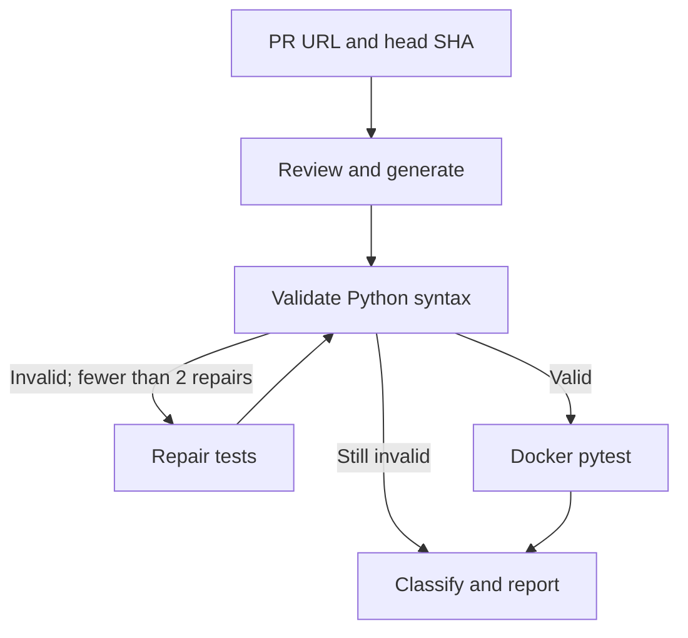

# Agentic AI QA Copilot

A LangGraph workflow that reviews a GitHub pull request, generates Python tests, validates the generated code, runs valid tests in a restricted Docker container, and reports the observed pytest result. The CLI can post the report to the PR when configured with a GitHub token. A failing test is evidence to investigate, not automatic proof of a product bug.

The review and test generation use Groq's LLaMA 3.3 70B model through LiteLLM. Validation, execution, classification, and report formatting follow explicit Python rules.


## Why this exists

Code review text is useful, but a test run gives the reviewer concrete execution evidence: the proposed assertion, pytest output, exit code, and the code version under review. The evidence still needs interpretation. A generated test can assert the wrong behavior, pass trivially, or fail because its setup is incomplete.

An earlier demo PR produced findings around `login(None)`, email-address handling, and an SQL-injection-shaped input. Those observations are useful examples to inspect in the demo; whether each is a product defect depends on the intended requirements. The Week 4 evaluation below uses separate, controlled fixtures.

## Workflow

1. Fetch PR metadata, a diff, and supported changed text files; record the PR head commit SHA. The intake checks whether the PR head or base changed during the fetch.
2. Ask the model to review the change and identify risk areas, then generate proposed pytest code.
3. Validate that the proposed code is nonempty and has valid Python syntax. On validation failure, request at most two repairs and revalidate each revision. If it remains invalid, report `INVALID_GEN` without running pytest.
4. Run syntax-valid tests in the `qa-copilot-runner` Docker image and capture the exit code, output, duration, and timeout flag.
5. Classify the result and render a Markdown report containing the PR head SHA, verdict, diagnostic, and available pytest log. The CLI's comment-posting path is separate from the local graph evaluation described below.



The graph uses a bounded conditional route. It does not rewrite an assertion merely because pytest reports a failure.

### Outcome labels

| Code | Meaning |
|---|---|
| `PYTEST_OK` | Pytest exited 0. This alone does not establish useful coverage; skipped tests can also produce exit 0. |
| `TEST_FAILURE` | Pytest reported a failure. Inspect the assertion and the intended behavior before calling it a product defect. |
| `INVALID_GEN` | Generated code failed validation after the available repairs; pytest was skipped. |
| `NO_TESTS` | Pytest collected no tests. |
| `TIMEOUT` | The Docker test run exceeded its time limit. |
| `EXECUTION_ERROR` | Collection, runner setup, or another execution problem prevented a reliable test result. |

## Week 4 evidence — local fixtures

| Check | Observed result | What it establishes |
|---|---|---|
| Baseline | 3/3 expected outcomes matched | Passing assertion, failing assertion, and invalid Python took their expected routes. |
| Repair-routing tests with real Docker | 4/4 passed | A syntax error can recover on the first or second repair, repairs stop after two attempts, and a valid failed assertion stays intact. |
| Fixed-response evaluation | 20/20 matched | The expected labels and routes matched on 20 repeatable cases, including three injection-themed fixtures. |
| Langfuse | Three local traces visible | Recovery, exhausted repair, and controlled local Git-change routes were captured. |
| Controlled local Git fixture | `TEST_FAILURE` | A change from `return 4` to `return 3` failed a generated assertion expecting 4. The trace recorded the classification and about 0.22 seconds total duration. |

The evaluation substituted **fixed model responses**. Its 20/20 score measures those fixtures and the tested workflow, not live-model test quality, broad prompt-injection resistance, or the probability of finding bugs in arbitrary PRs. The controlled PR example used a temporary **local Git repository** and a placeholder PR URL; it did not fetch a real GitHub PR or post a comment.

Coverage and model token/cost metrics were **not measured** in this Week 4 run. They are not included in the outcome score.

### Example report excerpt

The controlled local change made `value()` return 3 when the test expected 4. The report preserved the failing assertion instead of rewriting it:

```text
# QA Pipeline Report — controlled_local_pr
Reviewed PR head commit `<local fixture SHA>`.

## Verdict
### ❌ Test failure reported
Pytest reported a test failure. Review the test and its output.

Runner exit code `1`.
FAILED test_generated.py::test_value - assert 3 == 4
```

### Reproduce the local checks

From the tested project checkout, with Python 3.11+ and Docker Desktop running:

```bash
.venv/bin/python -m pip install -r requirements.txt
"$HOME/.docker/bin/docker" build -f Dockerfile.runner -t qa-copilot-runner .
QA_TEST_REAL_DOCKER=1 .venv/bin/python -m pytest -v tests/test_repair_routing.py
.venv/bin/python evals/run_week4_evaluation.py --output week4_evaluation.json
```

The 20-case evaluation includes a deliberate 30-second timeout case. The results JSON is a local generated artifact. Commit `evals/run_week4_evaluation.py` before presenting the evaluation as reproducible from a fresh checkout. The separate closeout script `run_week4_closeout.py` produced the three local Langfuse traces and saved `week4_closeout/controlled_local_pr_report.md` and `week4_closeout/trace_evidence.json`; add that script to `evals/` and document its invocation before presenting the trace run as reproducible from a fresh checkout.

## Getting started and running the CLI

Use Python 3.11+ and Docker Desktop. From the QA Copilot project root on the tested branch:

```bash
python3 -m venv .venv
.venv/bin/python -m pip install -r requirements.txt
"$HOME/.docker/bin/docker" build -f Dockerfile.runner -t qa-copilot-runner .
```

On systems where `docker` is already on `PATH`, use `docker` instead of `$HOME/.docker/bin/docker`. Place credentials in a local `.env` file:

```text
GROQ_API_KEY=your_key
GITHUB_TOKEN=your_token
```

Run the CLI with a PR URL:

```bash
.venv/bin/python main.py https://github.com/OWNER/REPO/pull/NUMBER
```

The current CLI attempts to **post a PR comment** after the graph completes. Use a PR you control and a token with only the permissions required for that PR. This end-to-end GitHub intake and posting path was **not verified by the Week 4 local fixtures**.

The application `Dockerfile` builds the outer CLI image. The Week 4 runner uses a second Docker image launched by the host Docker daemon; the older `docker run --env-file .env qa-pipeline ...` instructions do not set up that nested runner path and are not a verified v2 command.

## Components

| Path | Responsibility |
|---|---|
| `agents/graph.py` | LangGraph nodes, conditional route, and two-repair bound |
| `agents/state.py` | Typed workflow state and outcome definitions |
| `agents/validation.py` | Generated-code syntax validation |
| `agents/nodes/` | Review, generation/repair, execution, classification, and report nodes |
| `tools/github_utils.py` | GitHub PR intake and comment-posting functions |
| `tools/docker_runner.py` | Restricted container invocation and execution evidence |
| `tools/container_pytest.py`, `Dockerfile.runner` | In-container pytest entry point and non-root runner image |
| `tests/test_repair_routing.py` | Bounded-repair regression tests |
| `evals/run_week4_evaluation.py` | Twenty fixed-response evaluation cases |

## Execution controls and limits

The local runner is configured to run as a non-root user with networking disabled, a read-only root filesystem, dropped capabilities, no-new-privileges, memory/CPU/process limits, a bounded temporary workspace, and a 30-second host timeout. The evaluation exercised specific outcomes and one no-outbound-network fixture; it was **not a complete sandbox security assessment**.

The current syntax validator checks nonempty Python that compiles. It does not prove assertions are correct, symbols exist, imports are safe, or test coverage is meaningful. The runner receives the supplied changed files, so cross-file dependencies and non-text PR files need additional handling. The PR comment path, live model quality, coverage, and cost need separate verification.

## Technology

| Layer | Tools |
|---|---|
| Orchestration and generation | Python, LangGraph, LiteLLM, Groq (LLaMA 3.3 70B) |
| GitHub intake and reporting | PyGithub, `requests` |
| Test execution | pytest and a dedicated Docker runner image |
| Local tracing exercise | Langfuse; not required for the ordinary CLI run |
| Existing CI | GitHub Actions import and application-image build checks; the live pipeline and 20-case evaluation are not part of those checks |

## Next checks

- Verify the intake and comment-posting path with a PR you control, separately from the local fixtures.
- Measure test coverage and model usage/cost before adding those metrics to a results table.
- Evaluate fresh LLM responses on labeled PRs to measure test relevance and bug-finding ability.
- Extend changed-file handling for cross-file dependencies, deleted files, and non-text content.
