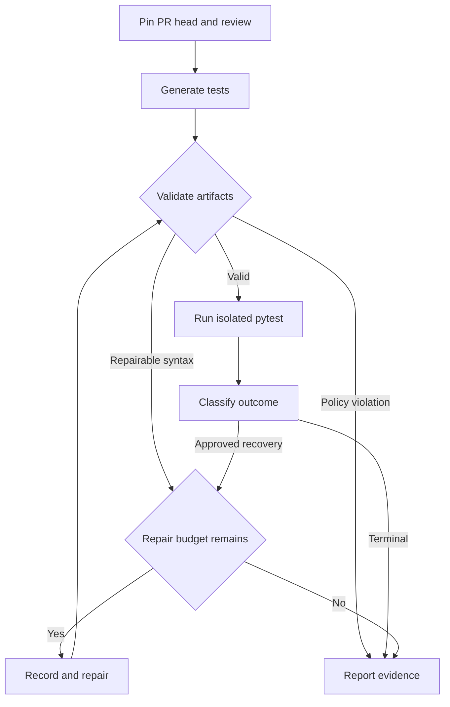

# QA Copilot v2 design

Architecture draft based on the published workflow at commit [`4199f7d`](https://github.com/ujjwaldahiya399/Agentic-AI-QA-Copilot/tree/4199f7d2581247b6e4fd6250653cc91cd0426ba5). The current behavior below comes from source inspection. The v2 routes and controls are proposed.

## Current workflow

| Source | Behavior relevant to v2 |
|---|---|
| `main.py`, `tools/github_utils.py` | The CLI accepts a PR URL, loads its diff and changed-file content, invokes the graph, and posts its report to the PR. File content is requested by branch name, so the state needs an immutable PR head identity. |
| `agents/graph.py`, `agents/state.py` | The graph has a fixed path through `code_review`, `test_runner`, and `report`. State holds source and free-text outputs. |
| `agents/nodes/test_runner.py` | One node generates pytest code, extracts it from the response, writes the changed files and tests to a temporary directory, and calls pytest with a 30-second timeout. The result discards the exit code and returns concatenated output or a timeout message. |
| `agents/nodes/report.py` | The report derives its verdict by matching pass and fail counts in text. A timeout or collection error with neither count can be reported as “No Tests Found.” |
| `Dockerfile` | The app image uses a non-root account. v2 needs a separate execution environment for generated tests and repository code, with resource limits and access isolated from the app's credentials. |

## Proposed workflow

| State | Evidence to keep |
|---|---|
| Source | Repository, PR number, head SHA, changed paths, review risks |
| Generated artifacts | Validated test paths and exact content or artifact hashes |
| Validation | Rule ID, file, line, and diagnostic |
| Execution | Exit code, collected test IDs and outcomes, bounded logs, timeout flag, and duration |
| Routing | Failure category, immutable attempt history, and remaining budget |

Use a structured schema for generated artifacts and reject unsafe paths before writing files. Run syntax checks before execution. Use an ephemeral runner with no credentials or network, a read-only source mount, a writable temporary mount, and CPU, memory, and time limits. Keep PR reporting in the trusted process.

## Failure routes and acceptance checks

| Case | Expected result |
|---|---|
| Generated test has invalid syntax | Block execution and preserve the diagnostic. Permit up to two generated-test repair attempts per run. Each attempt returns through validation. |
| A valid test assertion fails | Preserve the test and failure evidence. Investigate the expectation before labeling it a product bug. |
| Recognized execution setup failure | Allow one predefined environment recovery. Preserve both attempts and stop if the recovery fails. |
| No tests, collection error, timeout, policy violation, or unknown result | Return the specific outcome and evidence. A forbidden file or network operation must surface as a blocked execution. |
| Tests pass | Report collected tests and structured outcomes. Include coverage only when measured. |

Implement the state and artifact validator first. Use deterministic fixtures to test classification and stopping behavior before wiring model-generated repairs. Treat the published runner's hard-coded Groq model as a configuration dependency to verify independently before a live run.
